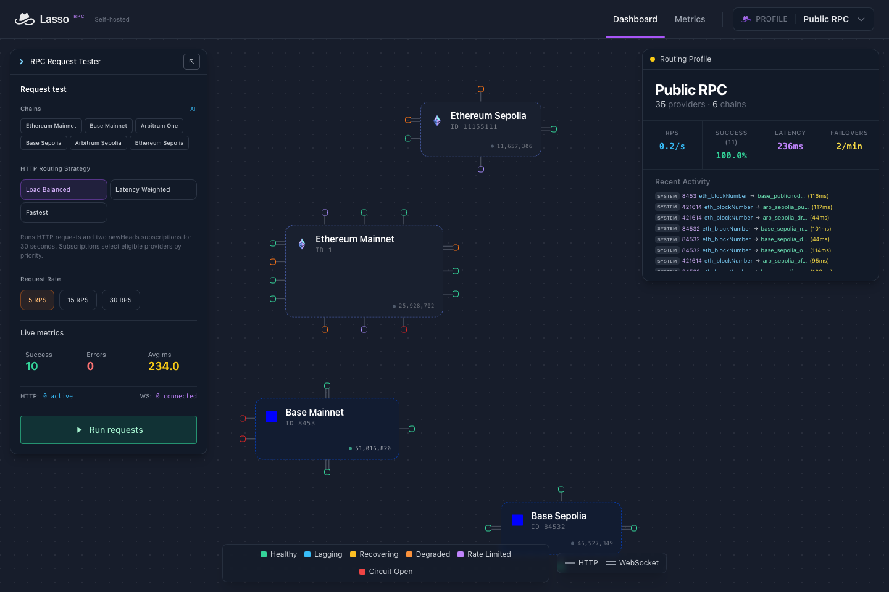

<h1 align="left">

</h1>

### Smart RPC routing for all your nodes and providers.

[](https://github.com/jaxernst/lasso-rpc/actions/workflows/ci.yml?query=branch%3Amain)
[](https://github.com/jaxernst/lasso-rpc/releases/tag/v0.10.0)
[](LICENSE.md)  
[](#documentation)
[](https://x.com/lassoRPC)

Lasso wrangles your nodes and RPC providers into one fast, resilient, and observable
JSON-RPC endpoint. It adapts to transient failures, absorbs provider inconsistencies,
and learns the optimal path for your app's RPC workload. Use it to aggregate all your RPC
infra and tune your RPC throughput and performance without redeploys.

Express routing controls right in the RPC endpoint path:

```
/rpc/balanced-fast/ethereum  -> spread load, weighted toward the fastest providers (the default)
/rpc/fastest/ethereum        -> route to the fastest provider by latency per method type and transport
/rpc/load-balanced/ethereum  -> spread requests evenly across healthy providers
/rpc/priority/ethereum       -> your provider priority and fallback order
```

Build custom routing pools for all your environments and configure each to optimize for
its workload:

```
/rpc/profile/prod/fastest/ethereum     -> subscribe_new_heads: true, http_heads_interval_ms: 2000
/rpc/profile/staging/priority/ethereum -> background_observations: false
```

Run your own Lasso proxy, deploy it to your own infra, or use hosted, edge-routed custom
RPC profiles at [lasso.sh](https://lasso.sh).

Apache-2.0 core built on Elixir/OTP. The bundled public pool aggregates public providers
across Ethereum, Base, Arbitrum, BSC, Tempo, Robinhood Chain, and more.

Add any additional EVM chain and your own providers in YAML, and Lasso will learn each
provider's method, history and log-range limits from live traffic.

[Quick Start](#quick-start) · [Use it from your app](#use-it-from-your-app) ·
[Configuration](#configuration) · [Endpoints](#endpoints) ·
[How it works](#how-it-works) · [Migration guide](docs/MIGRATION.md) ·
[Documentation](#documentation) · [Support](SUPPORT.md)

## Why Lasso

Every RPC provider is a bundle of tradeoffs: latency, uptime, rate limits,
archive depth, method support, and cost. Those tradeoffs shift by region, method,
and hour, and "compatible" JSON-RPC APIs disagree in the details. A single URL in
an environment variable makes all of that your application's problem.

Lasso makes it the RPC layer's problem. Different providers excel at different
work: hot reads, archival queries, log scans, subscriptions. Lasso measures that
live and routes each request accordingly. You get redundancy without rewrites,
and you scale by adding providers instead of replatforming.

## What Lasso handles

- **Outages and rate limits.** Circuit breakers pull a failing provider from
  rotation and reads fail over to the next healthy one. Recovered providers are
  eased back in. An `eth_sendRawTransaction` is
  [tried on up to three providers](docs/RPC_STANDARDS.md#transaction-sends), one
  at a time, not counting a provider that refuses it outright with a rate-limit
  or quota answer or because it does not support the method, and before
  returning a rejection Lasso looks up the transaction by its hash.
- **Uneven performance.** A provider can be fast for `eth_call` and slow for
  `eth_getLogs`. Lasso tracks latency per provider, transport, and kind of request
  (basic reads, state, logs, trace, transactions, subscriptions), and `fastest`
  sends each call to the quickest provider for its kind.
- **Mixed fleets.** Providers that refuse a method, lack the history a request
  needs, or reject a wide log range are moved behind ones that can serve it, and
  `?include_meta=body` shows why. You can also declare pruned providers, log-range
  caps, or no `debug` and `trace` up front.
- **Dropped WebSockets.** Matching `newHeads` and `logs` subscriptions share one
  upstream. When it fails, Lasso moves to another provider and backfills missed
  blocks and logs over HTTP.
- **Block height going backwards.** With
  [block regression protection](docs/BLOCK_CONTINUITY.md), successive
  latest-block responses never regress, even as providers change.
- **Knowing what happened.** Add `?include_meta=body` to see the provider,
  strategy, latency, and retries behind any response, or watch routing live in
  the dashboard.

Profiles give each app or environment its own providers, chains, and routing
from one deployment. Run a node per region and each routes from its own
measurements; optional clustering brings every region into one dashboard.

### Why not client-side fallback?

Fallback in your client runs separately in every service and process you deploy.
Each keeps its own picture of provider health, changing providers means a
redeploy, and nothing records which upstream answered. Lasso moves that into one
endpoint: shared measurements, one place to change providers, and a record of
every routing decision.



The dashboard shows each provider's health, circuit state, block freshness, and
latency as the node you are viewing measures them. Providers and routing live in
YAML, and a [reload](docs/DEPLOYMENT.md#custom-profiles-and-credentials)
applies an edit to the running node without a restart.

## Quick Start

You need Docker with the Compose plugin, curl, and OpenSSL. Start in an empty directory:

```bash
mkdir lasso && cd lasso
curl --fail --location https://github.com/jaxernst/lasso-rpc/releases/download/v0.10.0/compose.yml --output compose.yml
(umask 077; printf 'SECRET_KEY_BASE=%s\nRELEASE_COOKIE=%s\n' "$(openssl rand -hex 64)" "$(openssl rand -hex 32)" > .env)
docker compose up -d --wait
curl --fail http://localhost:4000/api/health
```

Open **<http://localhost:4000/dashboard>**. The prebuilt image supports Linux AMD64
and ARM64; no source checkout or build tools required.

Without Docker on Linux, download the standalone archive for x86_64 or aarch64
from the
[v0.10.0 release](https://github.com/jaxernst/lasso-rpc/releases/tag/v0.10.0). It
runs without Erlang, Docker or environment variables and serves the bundled
profiles on port 4000:

```bash
gh release download v0.10.0 --repo jaxernst/lasso-rpc --pattern 'lasso-*-linux-x86_64.tar.gz'
tar -xzf lasso-*-linux-x86_64.tar.gz
lasso/bin/lasso start
```

On macOS, run the Docker image. The macOS archive for Apple silicon is unsigned
and meant for bundling Lasso inside another application's install. If macOS
blocks a copy downloaded in a browser, clear the quarantine flag on the
downloaded file before unpacking it: `xattr -d com.apple.quarantine <file>`.

See [Standalone Archives](docs/DEPLOYMENT.md#standalone-archives) for each
platform's requirements, checksums and build provenance.

Send a request through the `fastest` strategy and ask Lasso where it went:

```bash
curl --fail-with-body --silent --show-error \
  'http://localhost:4000/rpc/fastest/ethereum?include_meta=body' \
  -H 'Content-Type: application/json' \
  -d '{"jsonrpc":"2.0","method":"eth_blockNumber","params":[],"id":1}'
```

```json
{
  "jsonrpc": "2.0",
  "id": 1,
  "result": "0x18ba3fb",
  "lasso_meta": {
    "strategy": "fastest",
    "selected_provider": {"id": "ethereum_publicnode"},
    "upstream_latency_ms": 45,
    "retries": 0,
    "circuit_breaker_state": "closed"
  }
}
```

Drop `include_meta` and the response is ordinary JSON-RPC. Metadata can also
arrive as headers or, over WebSocket, as a separate frame; see the
[API reference](docs/API_REFERENCE.md#observability-metadata).

To watch a live subscription, use the dashboard tester or
[`wscat`](https://github.com/websockets/wscat):

```bash
npx --yes wscat -c ws://localhost:4000/ws/rpc/ethereum
```

At the `>` prompt, send:

```json
{"jsonrpc":"2.0","method":"eth_subscribe","params":["newHeads"],"id":1}
```

You'll get a subscription ID, then an `eth_subscription` notification for every
new block.

## Use it from your app

Any JSON-RPC client works. Swap the provider URL for a Lasso URL:

```ts
import { createPublicClient, http, webSocket } from "viem";
import { mainnet } from "viem/chains";

const client = createPublicClient({
  chain: mainnet,
  transport: http("http://localhost:4000/rpc/fastest/ethereum"),
});

const wsClient = createPublicClient({
  chain: mainnet,
  transport: webSocket("ws://localhost:4000/ws/rpc/ethereum"),
});
```

```ts
import { JsonRpcProvider } from "ethers";

const provider = new JsonRpcProvider("http://localhost:4000/rpc/ethereum");
```

Because the strategy lives in the URL, each client can pick its own: `fastest`
for user-facing reads, `load-balanced` for background jobs.

## Before exposing Lasso

Lasso does not authenticate clients or enforce incoming RPC quotas. Put
externally reachable RPC, metrics, and dashboard endpoints behind your network
policy or a reverse proxy. The dashboard tester sends real upstream requests.

Compose binds to localhost and keeps profiles and history in a named volume.
Preserve `.env` across restarts. `docker compose down` keeps your data;
`--volumes` deletes it. See [Deployment](docs/DEPLOYMENT.md#docker) for
[verifying the image](https://github.com/jaxernst/lasso-rpc/releases/latest/download/container-verification.md),
custom providers, upgrades, and rollback.

## Configuration

Profiles are YAML files. In Docker, follow the
[host-mounted profile setup](docs/DEPLOYMENT.md#custom-profiles-and-credentials);
in a source checkout, edit `config/profiles/`. Keep a valid `public.yml` and match
each additional filename to its `slug`.

Save this as `my-app.yml` in your profiles directory:

```yaml
---
name: My App
slug: my-app
---
chains:
  ethereum:
    chain_id: 1
    providers:
      - id: publicnode
        url: https://ethereum-rpc.publicnode.com
        ws_url: wss://ethereum-rpc.publicnode.com
      - id: drpc
        url: https://eth.drpc.org
        ws_url: wss://eth.drpc.org
```

Swap in your own nodes and providers. URLs and auth headers support
`${ENV_VAR}` substitution, and an unresolved variable rejects the configuration
instead of starting with a broken provider. Declare
[capabilities](docs/CONFIGURATION.md#provider-capabilities) such as unsupported
methods, log-range limits, and pruning depth so Lasso routes around them. From a
source checkout, `mix lasso.probe <provider_url>` tests a provider's method
support, limits, and WebSocket subscriptions and recommends capability settings.
It reports transaction submission methods as unverifiable:
an invalid payload cannot prove support, and discovery never submits a real
transaction. Test transaction behavior with your own controlled workload.

Recreate the container after adding a profile:

```bash
docker compose up -d --force-recreate --wait
```

Then use `http://localhost:4000/rpc/profile/my-app/ethereum` or
`ws://localhost:4000/ws/rpc/profile/my-app/ethereum`. Later YAML edits apply
with a [configuration reload](docs/DEPLOYMENT.md#custom-profiles-and-credentials);
a failed reload keeps the active configuration. Environment or mount changes
need a container recreate.

Profiles separate routing configuration; they are not access controls. Profile
`rps_limit` applies to the dashboard tester, not incoming RPC traffic.

### Head tracking and provider quota

Lasso tracks every provider's block height so it can tell when one falls
behind. That tracking runs on every node and spends provider quota beside your
own traffic. With no cadence overrides, each distinct upstream costs:

| Background request | Rate per upstream, per node |
|--------------------|-----------------------------|
| `newHeads` notification, when the provider has a `ws_url` | One per block, pushed by the provider; it does not spend a `request_budget` |
| `eth_blockNumber` | One per `max(2 × block_time_ms, 5 s)`, or 12 s without `block_time_ms`; three times that interval while its feed is current |
| `eth_chainId` | One per 30 min |

Successful routed `eth_blockNumber` and `eth_getBlockByNumber("latest")`
responses also provide head evidence for the provider that served them. A chain
needs one head feed, and any provider with a free WebSocket can carry it.
Declare a provider `request_budget` to cap combined client attempts and
background work on each node:

```yaml
providers:
  - id: metered
    url: https://rpc.example.com/${METERED_KEY}
    request_budget:
      requests_per_second: 3
      burst: 20
```

The bucket is shared across profiles and HTTP/WebSocket transports. When spent,
client requests try another provider and background polls skip the tick without
penalizing provider health. If every eligible route is spent, Lasso returns
`-32005` with a retry delay. WebSocket notifications and upgrades do not spend
tokens. Omit `burst` for one second's allowance, or omit `request_budget` for
unlimited outbound requests. Provider details show admitted/refused totals per
upstream. See [outbound budgets](docs/CONFIGURATION.md#outbound-request-budget)
for identity, reload and per-node semantics.

To avoid periodic work entirely, turn background tracking off:

```yaml
providers:
  - id: own-node
    url: http://10.0.0.5:8545
    ws_url: ws://10.0.0.5:8546
  - id: metered
    url: https://rpc.example.com/${METERED_KEY}
    background_observations: false
```

A provider with `background_observations: false` keeps serving requests and
subscriptions, and Lasso learns its height from the head reads routed to it.
Profiles sharing the same upstream share its background work; another enabled
reference can keep that work running. The
[configuration reference](docs/CONFIGURATION.md#monitoring) lists the intervals
and per-provider overrides.

Current limits:

- Lasso prefers a current provider only once it has observed each provider's
  head, from background polling, `newHeads` or head reads routed through it.
- Head comparison assumes 12-second blocks unless `block_time_ms` is set, so
  set it on faster chains.
- Methods Lasso does not recognize, such as vendor extensions, get one attempt
  on whichever provider the strategy picks. List them in `unsupported_methods`
  on providers that lack them, or send them to
  `/rpc/provider/:provider_id/:chain`.

## Endpoints

| Route | HTTP (POST) | WebSocket |
|-------|-------------|-----------|
| Default | `/rpc/:chain` | `/ws/rpc/:chain` |
| Strategy | `/rpc/:strategy/:chain` | `/ws/rpc/:strategy/:chain` |
| Provider override | `/rpc/provider/:provider_id/:chain` | `/ws/rpc/provider/:provider_id/:chain` |
| Profile | `/rpc/profile/:profile/:chain` | `/ws/rpc/profile/:profile/:chain` |

Strategies are `load-balanced`, `fastest`, `balanced-fast` (the default), which
spreads load while favoring the quickest providers, and `priority`, which tries
providers in their configured `priority` order; `latency-weighted` is an alias of
`balanced-fast`.
Profile routes accept strategies and provider overrides too; see the
[API reference](docs/API_REFERENCE.md).

`:chain` is a configured name such as `ethereum` or its EIP-155 ID, `1`. Routes
without a profile use `public`.

`GET /api/health` reports liveness and bare `GET /api/ready` reports replica
readiness. Use `/api/ready?profile=public&chain=ethereum` for strict routing
readiness; [Deployment](docs/DEPLOYMENT.md) describes these probes.

## Troubleshooting

Start with container status and recent logs:

```bash
docker compose ps -a
docker compose logs --tail=100 lasso
```

| Symptom | Check |
|---------|-------|
| Container fails to start | Look for missing environment variables or invalid YAML in the logs. Keep `public.yml`; profile filenames must match their slugs. |
| Port 4000 is in use | Set `LASSO_PORT=4001` in `.env`, run `docker compose up -d --wait`, and use port 4001. |
| Health passes but RPC fails | Health covers Lasso itself, not upstreams. Check provider status in the dashboard, credentials, and network access. |
| Profile changes have no effect | Reload existing profiles on each node. After adding a profile or changing `.env` or mounts, run `docker compose up -d --force-recreate --wait`. |

## Run from source

Use Elixir 1.18.4 and Erlang/OTP 28 (the CI versions), plus Node.js 18 or newer
for assets:

```bash
git clone https://github.com/jaxernst/lasso-rpc
cd lasso-rpc
mix deps.get
mix assets.setup
mix assets.build
mix phx.server
```

Open <http://localhost:4000/dashboard>. See [Contributing](CONTRIBUTING.md) for
tests and code quality checks. To build a production container from the checkout,
set `SECRET_KEY_BASE` and run `docker compose up --build -d`, or use
`./run-docker.sh`.

## How it works

For each request, Lasso filters providers by method, transport, declared
capabilities, and health, ranks the rest with the selected strategy, and executes
with retries and failover. Every attempt feeds back into the measurements that
drive the next decision and the dashboard. See [Routing](docs/ROUTING.md) and
[Architecture](docs/ARCHITECTURE.md).

A single node works standalone. For global traffic, run a node per region behind
geo DNS or a load balancer: each node routes from its own local measurements, so
regional latency differences are handled automatically. Optional
[clustering](docs/DEPLOYMENT.md#multi-node-clustering) aggregates observability
across regions without touching the routing hot path.

### Why Elixir/OTP

RPC routing is a concurrency and failure-handling problem, which is exactly what
the BEAM was built for.

- **Massive concurrency:** lightweight processes model every request, provider
  connection, and subscription without shared-memory complexity.
- **Fault isolation:** OTP supervision contains failures and restarts components
  fast, which matters when upstreams are flaky or rate-limited.
- **Fast shared state:** ETS serves routing, benchmark, and breaker state on the
  hot path without a central bottleneck.
- **Distributed by design:** clustering and remote messaging are built into the
  runtime.

## Direction

Lasso's routing is built to learn. Method support, history depth, and log-range
limits are already learned from live traffic. More provider behavior should be
discovered from probes and live traffic, attributed to evidence, and shown to
operators instead of hand-written into config. Observations stay typed, so
provider comparison can grow from head height to fork-aware checks on headers,
logs, and responses.

## Documentation

- [Configuration](docs/CONFIGURATION.md): YAML, credentials, capabilities, and strategies
- [Routing](docs/ROUTING.md): the selection pipeline and each strategy
- [API reference](docs/API_REFERENCE.md): routes, metadata, subscriptions, and errors
- [Block regression protection](docs/BLOCK_CONTINUITY.md) and [reading at one block](docs/READ_AT_ONE_BLOCK.md)
- [Migration guide](docs/MIGRATION.md): move from direct providers or another gateway with a measured canary
- [Deployment](docs/DEPLOYMENT.md): containers, standalone archives, persistence, upgrades, and clustering
- [Observability](docs/OBSERVABILITY.md): logs and metrics
- [RPC standards](docs/RPC_STANDARDS.md): method support and execution semantics
- [Testing](docs/TESTING.md) and [Changelog](CHANGELOG.md)

Prefer a managed deployment? [Lasso Cloud](https://lasso.sh) runs this engine
with hosted providers, API keys, and usage analytics. See the
[Cloud docs](https://docs.lasso.sh/cloud/adoption). Its
[status page](https://status.lasso.sh/) shows live
status and 90 days of uptime from an external monitor.

Leaving Cloud means running this repository. A Cloud Custom profile exports as
a Core YAML profile with provider URLs replaced by environment references, so
the same providers and routing settings start here with your own secrets. Your
app keeps standard JSON-RPC and changes only its RPC URL.

To run an exported profile, finish the [Quick Start](#quick-start), then:

1. Add each variable named in the export's header comment to `.env`, set to the
   provider URL or header value it stands for.
2. Set up [host-mounted profiles](docs/DEPLOYMENT.md#custom-profiles-and-credentials)
   and save the export in `profiles/` as `<slug>.yml`, using the `slug` from its
   frontmatter. Lasso loads a profile only from a file named `<slug>.yml`; a file
   under any other name, such as `<slug>.yaml`, is not loaded.
3. Run `docker compose up -d --force-recreate --wait`, then
   `docker compose exec -T lasso /app/bin/lasso check-config` and confirm the
   profile count includes yours.
4. Send requests to `http://localhost:4000/rpc/profile/<slug>/<chain>`.

## Contributing

See [Contributing](CONTRIBUTING.md) for setup and checks. Report bugs through
[GitHub issues](https://github.com/jaxernst/lasso-rpc/issues), and open an issue
to discuss major changes before sending a pull request. Ownership and review
responsibilities are in [Maintainers](MAINTAINERS.md); deployment help is in
[Support](SUPPORT.md).

## Security

See the [Security Policy](SECURITY.md) for deployment guidance and private
vulnerability reporting.

## License

[Apache License 2.0](LICENSE.md). Built by [jaxer.eth](https://farcaster.xyz/jaxer.eth).
